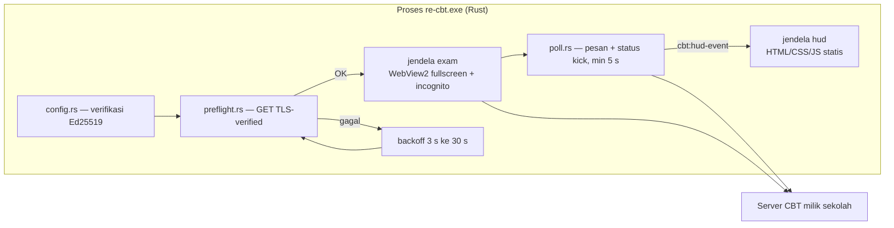

# RE-CBT

Klien ujian CBT (Computer-Based Test) yang **aman dan cepat**, ditulis ulang
dari nol di **Rust + Tauri 2**. Proyek ini adalah kelanjutan langsung dari
riset reverse engineering [teardown-CBT](https://github.com/aditiya-saputra/teardown-CBT)
pada klien `ExamBrowser 26.0222` hasil dekompilasi `.NET` + deobfuscation
`main.js` Electron (webcrack). Seluruh kelemahan yang terbukti di sana
kita perbaiki di sini, bukan di-patch.

> **Lingkup & etika:** RE-CBT dibuat untuk server CBT yang **dimiliki dan
> dikelola sendiri** (sekolah/kampus). Ini **bukan** alat untuk menembus atau
> menipu ujian pihak ketiga. Konfigurasi ditandatangani Ed25519 oleh admin:
> tanpa kunci privat, tidak ada yang bisa mengoverride perilaku klien.

---

## Kenapa Rust

| Kebutuhan | Jawaban |
|---|---|
| Kecepatan | Binary tunggal tanpa runtime Electron (+100 MB), startup ~detik, memory footprint kecil |
| Keamanan ujian | TLS selalu terverifikasi (`rustls`), tanpa Node di renderer, konfigurasi tertanda tangan kiris (signing), interval polling anti-hammering |

## Peta perbaikan (teardown-CBT → RE-CBT)

| # | Temuan klien lama (bukti di teardown-CBT) | RE-CBT |
|---|---|---|
| 1 | `did-navigate` membandingkan string vs number → handler HTTP 500 **mati total** (baris 323–325) | `preflight.rs`: GET terverifikasi TLS sebelum jendela ujian dibuka; status gagal eksplisit dgn retry backoff 3→30 s + HUD |
| 2 | `Object.assign(windowParams, …)` memutasi global (305/326/466) | `Config` adalah `Arc` immutable; window dibangun dari nilai, tanpa state global |
| 3 | Error-window `nodeIntegration: true` → jalur RCE dari `404.html` (308) | Tidak ada Node sama sekali: renderer Tauri (WebView2) + CSP ketat di `tauri.conf.json` |
| 4 | `NODE_TLS_REJECT_UNAUTHORIZED = 0` + `ignore-certificate-errors` → semua TLS mati (400) | Tidak ada opsi komplemen TLS: reqwest **default rustls webpki-roots**, verifikasi tak bisa dimatikan dari konfigurasi |
| 5 | `setInterval(fn, undefined)` → clamp 1 ms → hammering server + CPU spin (389/455) | `MIN_POLL_MILLIS = 5_000` dipaksa di `config::validate_and_adjust` + backoff >60 s saat error (unit test ada) |
| 6–8 | implicit global, 3 listener terpisah, logika `statuskirim` terbalik | Rust: type-checked, `Send`/ownership ditegakkan kompiler |
| 9 | `fs.writeFile` error diabaikan (`if (err) {} else {}`) | Semua I/O mengembalikan `Result`; kegagalan HUD/log eksplisit |
| 11 | API deprecated (`new-window`) | API Tauri 2 stabil |
| 12 | `clearCache()` setelah `loadURL` → race (106–109) | `.incognito(true)` — tidak ada cache ditulis dari awal |
| 13 | `executeJavaScript(...).catch(()=>{})` menelan rejek | Tidak ada scraping DOM — identitas peserta eksplisit dari konfigurasi |
| 14 | `appendSwitch` post-ready tidak berefek (dead switch) | Tidak ada switch Chromium tersembunyi |
| — | Konfigurasi AES-256-CBC dgn kunci `nji9vgy7xdr6` + IV hardcoded di binary (§4.1) | JSON konfigurasi **bertanda tangan Ed25519** (`config/re-cbt.json`), kunci publik terpisah `ed25519.pub`, kunci privat tidak pernah ada di klien |
| — | `User-Agent` disuntik dari `argv[1]` (114–120) | `user_agent` eksplisit di konfigurasi tertanda tangan |
| — | `username.json`/`pesan.json`/`kick.json` tersebar di disk dan rawan atauphan | Semua komunikasi via **event** `cbt:hud-event` ke HUD (reload semantik tanpa file) |
| — | Lockdown keyboard sebenarnya dikerjakan by `runningexam.exe` di level OS (§10) | v0.1 fullscreen + `content_protected(true)` (≈ `setContentProtection`); lockdown keyboard OS-level masuk roadmap |

## Arsitektur



## Cara pakai

### 0. Prasyarat

- **Rust stable** (≥ 1.85). Cek: `rustc --version`
- **WebView2 Runtime** (bawaan Windows 10/11)
- Untuk `cargo build`/`cargo run` **lokal di Windows**: [Visual Studio Build Tools](https://visualstudio.microsoft.com/visual-cpp-build-tools/) (MSVC). `cargo check`/`cargo test` unit-konfigurasi tidak butuh linker; CI GitHub (windows-latest) menyediakan MSVC otomatis.

### 1. Admin: buat kunci + tandatangani konfigurasi

```pwsh
cp examples/payload.json my-cbt.json   # lalu edit sesuai server Anda
re-cbt genkey --out-dir config         # ed25519.priv + ed25519.pub
re-cbt sign my-cbt.json --key config/ed25519.priv --out config/re-cbt.json
```

`config/re-cbt.json` berisi `{payload_b64, signature_hex}`; `config/ed25519.pub`
harus berada sebelahnya (dibaca otomatis). **`ed25519.priv` jangan pernah
ada di mesin peserta.**

### 2. Peserta: jalankan

```pwsh
re-cbt                # default config/re-cbt.json
re-cbt D:\kiosk\config\re-cbt.json
```

Alur: HUD menampilkan status koneksi → preflight → jendela ujian fullscreen
(TLS tervalidasi, tanpa cache disk) → polling pesan pengawas & status kick
(min. tiap 5 s, backoff 60 s bila gagal) → jika pengawas mengeluarkan peserta,
HUD menampilkan alasan → exit dalam 15 s (dapat diubah `kick_grace_ms`).

### 3. CLI

| Perintah | Fungsi |
|---|---|
| `re-cbt [path]` | jalankan klien (default `config/re-cbt.json`) |
| `re-cbt genkey [--out-dir <dir>]` | buat pasangan Ed25519 (`.priv`/`.pub`, hex) |
| `re-cbt sign <payload.json> --key <ed25519.priv> [--out <out.json>]` | validasi + tanda tangani konfigurasi |
| `re-cbt help` | bantuan |

## Schema konfigurasi (`payload`)

| Field | Wajib | Default | Keterangan |
|---|---|---|---|
| `exam_url` | ✔ | — | HTTPS saja; halaman/paket ujian yang dimuat jendela utama |
| `supervisor_api_base` | ✔ | — | HTTPS; base URL API pengawas |
| `message_endpoint` | ✔ | — | template `api/task-get-pesan/{username}/{activity}` (tanpa `/` awal) |
| `status_endpoint` | ✔ | — | template `api/task-get-status-peserta/{username}/{activity}` |
| `user_agent` | ✔ | — | identitas UA kirim semua request |
| `getagent_url` | — | — | endpoint pembangkit token agent (paritas `urlgetagent` klien lama); wajib HTTPS bila diset; dipanggil **satu kali** (perbaikan temuan #23); token sukses jadi User-Agent **efekti**: preflight + jendela ujian + polling |
| `getagent_headers` | — | `{}` | header tambahan untuk `getagent_url` (auth/protokol endpoint); dari config tertanda tangan, **tanpa** nilai hardcoded di binary |
| `activity` | ✔ | — | kegiatan/ujian |
| `participant_username` | ✔ | — | identitas peserta (tidak scraping DOM) |
| `message_interval_ms` | — | 300000 | di-clamp ≥ 5000 |
| `status_interval_ms` | — | 60000 | di-clamp ≥ 5000 |
| `kick_grace_ms` | — | 15000 | jeda dialog → exit saat dikick (min 1000); dipakai juga sebagai jeda tampil HUD sebelum exit saat fatal |
| `fullscreen` | — | true | mode kiosk |
| `mode` | — | `online` | `online` (daring) atau `semi` (LAN terisolasi, setara `ModeUjian=1` klien lama) |
| `offline_probe_url` | ✔ jika `semi` | — | URL HTTPS untuk probe: request **berhasil** = internet terdeteksi = konfigurasi **ditolak** |
| `semi_subnet_prefix` | — | 24 | prefix subnet `exam_url` untuk verifikasi mesin di LAN ujian (hanya `semi`; maks 32) |
| `unlock_keys` | — | `control,c,b` | chord berurutan (jendela 1,5 s) meminta pintu operator — paritas `unlockkeys LControlKey,C,B`. Token kanonik: `control`/`alt`/`shift`/`meta`, huruf/digit, `f1`.. |
| `unlock_password` | ✔ | — | password operator (min 4 char); dibandingkan di **Rust**, HUD hanya pengantar; salah 5× = kunci 30 s |

## Buka-kunci opserta & sifat kiosk

| Jalur masuk | Perlakuan RE-CBT |
|---|---|
| `Alt+F4` / tombol ✕ / klik taskbar close | **ditolak** (`prevent_close` di Rust) |
| context-menu klik-kanan, F12, Ctrl+Shift+I/J/C, Ctrl+R/N/P/S/T/W/U, F5/F11 | dicekal init-script di renderer (block list konstanta di `kiosk.rs`) |
| chord `unlock_keys` di webview ujian | init-script memipakan tombol → mesin chord di `kiosk.rs` (state machine diuji unit) → HUD minta password |
| password benar di HUD | kartu "Terbuka" → exit bersih (exit 0) |
| password salah | HUD warning; 5× salah = kunci 30 dtk (anti-hammer) |
| keluar lainnya | kick pengawas (`status=2`) atau admin lewat OS — tidak ada hatch tersembunyi |

Jalur unlock hanya hidup bila chord ditekan di webview ujian (fokus); hook OS-level
global (paritas WH_KEYBOARD_LL `ExamServices`) = item roadmap.

Semua field konfigurasi final | Format ditolak jika: skema bukan HTTPS, field
kosong, template kehilangan `{username}`/`{activity}`, tanda tangan invalid,
atau aturan mode semi melanggar (host bukan IPv4 literal, `offline_probe_url`
hilang/bukan HTTPS, prefix > 32).
`deny_unknown_fields` aktif — typo field ditolak, bukan diam.

## Akses ANBK & token agent (paritas `urlgetagent`)

Klien lama mengambil **token User-Agent** lalu menyuntikkannya ke semua request
browser via `onBeforeSendHeaders` (`argv[1]`). RE-CBT menyediakan jalur yang
sama secara **config-driven** — tanpas secret di binary:

| Aspek token/UA `urlgetagent` lama | RE-CBT |
|---|---|
| Endpoint | `getagent_url` dari config (HTTPS wajib); contoh bawaan: `examples/payload-anbk.json` |
| Metode | **GET** (POST dikembalikan `411 Length Required` oleh server ANBK — verifikasi langsung) |
| Header | `getagent_headers` dari config; untuk ANBK: `reveal` + `Authorization` — keduanya **wajib**, tanpanya `payload.userAgent` berupa string kosong |
| Respons | JSON `payload.userAgent` — JWT (issuer Radyalabs, masa berlaku ±5 jam) |
| Pemanggilan | **satu kali per launch** (klien lama memanggil 2× — temuan #23) |
| Pemakaian token | `effective_ua` → preflight, `WebviewWindowBuilder.user_agent` jendela ujian, polling; paritas `argv[1]` |
| Gagal ambil token | HUD `Retry` + backoff (3 s → maks 30 s) — tanpa jendela asing |

Catatan verifikasi lapangan: halaman ujian ANBK (`anbk-siswa.*`) membalas 403
untuk GET polos maupun ber-token dari jaringan di luar lingkungan ujian
(WAF, bukan cerminan bug klien). RE-CBT dgn token asli tetap berjalan benar:
ambil 1 token (228 char), preflight golongkan 403 → HUD Retry → chord +
password tetap dapat membukakan exit bersih di fase retry.

## Dua mode: `online` vs `semi` (paritas `ModeUjian=2/1` klien lama)

| Aspek | Klien lama `ModeUjian=1` | RE-CBT `semi` | Klien lama `ModeUjian=2` | RE-CBT `online` |
|---|---|---|---|---|
| Jaringan ujian | LAN `https://192.168.0.200/` hardcoded | host `exam_url` (IPv4 literal, dari config) | internet penuh | bebas (HTTPS-only) |
| Pra-cek jaringan | subnet cocok + internet harus **tidak ada** | sama, tapi probe configurable via `offline_probe_url` | tidak ada | preflight TLS `exam_url` |
| Pelanggaran pra-cek | dialog → keluar | HUD `Fatal` → jeda `kick_grace_ms` → exit(1) | — | — |
| Token/UA | WCF + AES (passphrase hardcoded) | UA dari config (`semi` tanpa token server) | REST `urlgetagent` dipanggil 2× (temuan #23) | `getagent_url` dari config, dipanggil **1×**, token jadi UA efekti (opsional) |
| Polling pesan/kick | `api/task-get-pesan` + `task-get-status-peserta` | identik | identik | identik |

Catatan mode `semi`:

- `exam_url` dan `supervisor_api_base` wajib **IPv4 literal** — LAN terisolasi
  lazimnya tanpa DNS, dan subnet check membutuhkan alamat yang pasti.
- Probe internet memakai client rustls yang sama (TLS tervalidasi): sukses
  request ke `offline_probe_url` berarti jaringan tidak terisolasi → konfigurasi
  ditolak. Gagal DNS/route/timeout (5 dtk) = benar.
- Pilih probe host di luar jaringan sekolah (contoh: endpoint NCSI Microsoft);
  endpoint captive-proxy dalam negeri yang memalsukan sertifikat tidak lolos
  TLS dan tetap terbaca "offline".
- Kegagalan list antarmuka (`if-addrs`) dihitung gagal-tutup: tanpa IP lokal =
  subnet check menolak.
- Semua nilai (host LAN prefix, probe) datang dari konfigurasi Ed25519 — tidak
  ada IP/passphrase/URL yang mewarisi rahasia klien lama.

## Verifikasi

```pwsh
cargo check      # typecheck tanpa linker (jalur CI cepat)
cargo test       # unit test (config, chord unlock, subnet, validasi)
cargo clippy     # linter
cargo build      # butuh Build Tools MSVC di Windows
```

CI: `.github/workflows/ci.yml` — `cargo check`, `cargo test`, `cargo clippy`,
`cargo fmt --check` pada `windows-latest`.

## Roadmap

- [x] Blokir context-menu/DevTools/shortcut renderer di window ujian + anti Alt+F4 (`prevent_close` Rust)
- [x] Buka-kunci kiosk operator (chord configurable + password Rust + HUD prompt)
- [x] Pembangkit token agent (paritas `urlgetagent`, perbaikan 1× fetch temuan #23)
- [ ] Hook keyboard OS-level global (`WH_KEYBOARD_LL` paritas `ExamServices` saat window ujian tidak fokus)
- [ ] Re-check periodik tata-letak jaringan (subnet/internet) saat ujian `semi` berjalan
- [ ] Prokses kamera proktor (port `ExamCam` analisis di teardown-CBT)
- [ ] Bundler `tauri build` + ikon + installer MSIX
- [ ] File log terstruktur (tracing) + upload status tiap polling ke server
- [ ] Autoupdater channel-by-signature (Ed25519 juga yang menandatangani binary)

## Terkait proyek

- **teardown-CBT** — analisis rekayasa balik klien 26.0222: metode deobf
  (webcrack), peta 20 fungsi `main.js`, bug hunt 20 temuan (5 kritis),
  biolka decompiled `.NET`.
  Temuan #1–#5 di atas saling rujuk ke README analisis repo tersebut.

## Lisensi

MIT — lihat `LICENSE`.
